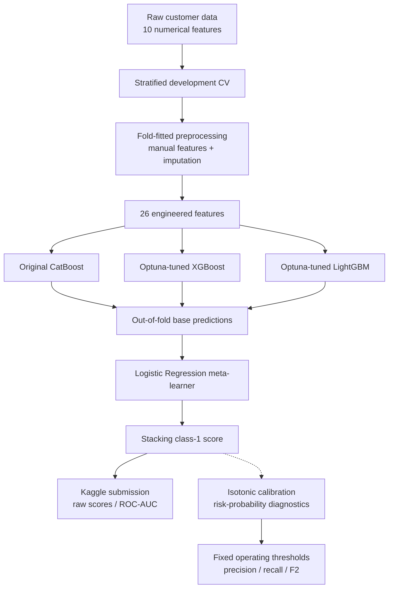
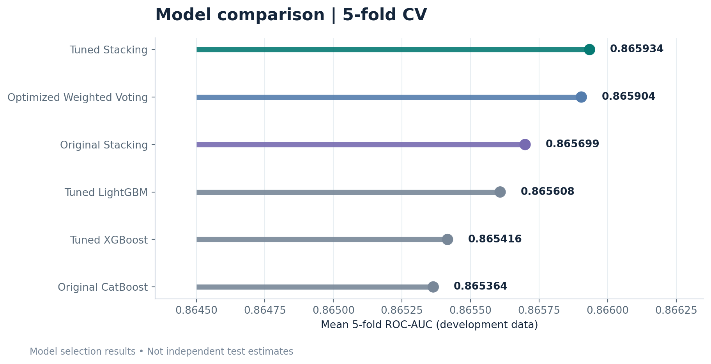
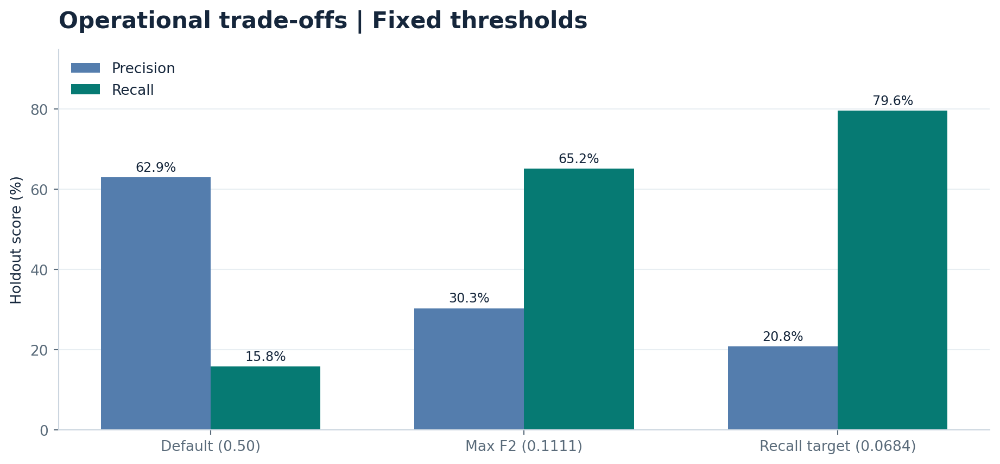
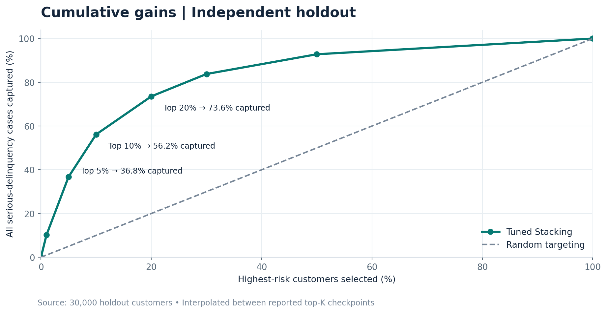
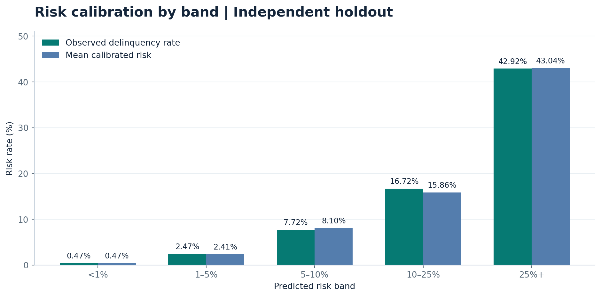

# Credit Risk Prediction - Explainable Stacking Ensemble

**An end-to-end machine learning study of serious credit delinquency: from leakage-safe preprocessing and imbalanced classification to ensemble learning, probability calibration, explainability, and Kaggle evaluation.**

[](https://www.python.org/)
[](https://scikit-learn.org/)
[](https://catboost.ai/)
[](https://xgboost.readthedocs.io/)
[](https://lightgbm.readthedocs.io/)
[](https://optuna.org/)
[](https://shap.readthedocs.io/)
[](https://www.kaggle.com/competitions/GiveMeSomeCredit)

> [!NOTE]
> **The leaderboard metric is ROC-AUC, not accuracy.** The final Kaggle model was retrained on all 150,000 labeled rows *after* evaluating an earlier, fixed development model on the 30,000-row holdout. The holdout metrics below describe that earlier model; the leaderboard metrics describe the final full-data model.

## At a glance

| Metric | Result | Evaluation |
|---|---:|---|
| **Kaggle private ROC-AUC** | **0.86818** | Hidden competition split |
| Kaggle public ROC-AUC | 0.86215 | Public competition split |
| Independent holdout ROC-AUC | **0.870111** | Uncalibrated stacking, 30,000 rows |
| Independent holdout average precision | **0.413180** | Uncalibrated stacking |
| 95% bootstrap CI, holdout ROC-AUC | **[0.861350, 0.878075]** | 1,000 paired bootstrap resamples |
| Isotonic Brier score | **0.048446** | Calibrated holdout predictions |
| Lift among highest-risk 10% | **5.62×** | Independent holdout |
| Final model training data | **150,000** | Full labeled competition train set |
| Unlabeled Kaggle test rows | **101,503** | Final `Id,Probability` submission |

## The problem

Predict whether a borrower will experience **serious delinquency (90 days past due or worse) within two years**, using the public [Kaggle Give Me Some Credit](https://www.kaggle.com/competitions/GiveMeSomeCredit) dataset.

The training data contains **150,000 labeled observations**, **10 raw numerical features**, and a positive-class prevalence of **6.684%** (10,026 positive cases). Such imbalance makes accuracy alone a poor indicator of minority-class detection.

The study has two separate goals:

- **Risk ranking:** maximize **ROC-AUC** for the Kaggle evaluation; the final submission contains unthresholded class-1 scores.
- **Operational risk assessment:** inspect **precision/recall trade-offs**, **calibrated event probabilities**, **lift**, and performance across customer segments. These diagnostics do not imply that the model is ready to make automated lending decisions.

## Model architecture



The **final stack** combines three fitted base pipelines—original CatBoost, tuned XGBoost, and tuned LightGBM—with a logistic regression meta-learner. Stacking uses **3-fold inner CV** to construct out-of-fold meta-features; model comparisons use **5-fold stratified CV**. Each base pipeline fits feature engineering and imputation **inside the training folds**, rather than reusing a transformation fitted on all development data.

### Feature engineering

Starting with 10 raw columns, the pipeline generates **26 numerical features** through selected missing-value indicators, zero indicators, and `log1p` transforms. Median imputation is fitted within the pipeline. Standard scaling is reserved for models that need it; the tree-based models use an unscaled preprocessing branch.

**Important:** The separately saved transformed-preview data was **not used for model cross-validation**. Fold-aware preprocessing prevents that form of training/validation leakage.

## Development experiments

We compared a dummy classifier, logistic regression, decision tree, random forest, extra trees, CatBoost, XGBoost, LightGBM, classical bagging, soft voting, and stacking. We also tested class weighting, random oversampling/undersampling, SMOTE, Borderline-SMOTE, ADASYN, and SMOTE-Tomek. A range of strategies raised minority-class recall at the default threshold, but **threshold optimization on unbalanced probabilities** achieved the desired recall without a substantial change to the model ranking quality.

Hyperparameters for CatBoost, XGBoost, and LightGBM were explored with **Optuna** using 3-fold development CV. The final stack retained the **original CatBoost**, and used **tuned XGBoost and tuned LightGBM**. Voting weights were optimized separately; their evaluation used outer folds so the weight search was not scored on those folds' validation labels.



| Development model | 5-fold ROC-AUC |
|---|---:|
| **Tuned Stacking** | **0.865934** |
| Optimized Weighted Soft Voting | 0.865904 |
| Original Stacking | 0.865699 |
| Tuned LightGBM | 0.865608 |
| Tuned XGBoost | 0.865416 |
| Original CatBoost | 0.865364 |

The gap between the top two ensembles is only **0.000030 ROC-AUC**; this is not evidence of a meaningful superiority. The simpler tuned LightGBM remains a relevant latency/cost baseline. Development CV estimates are also influenced by model selection and hyperparameter search; **independent holdout and Kaggle results** are reported separately.

## Independent holdout evaluation

Before retraining on all labeled rows, the selected stack was fitted on **120,000 development rows** and evaluated once on a reserved **30,000-row holdout**.

| Metric | Raw stacking score | Isotonic calibrated |
|---|---:|---:|
| ROC-AUC ↑ | **0.870111** | 0.869738 |
| Average precision ↑ | **0.413180** | 0.403677 |
| Brier score ↓ | 0.049839 | **0.048446** |
| Log loss ↓ | 0.186132 | **0.176267** |
| Estimated calibration error ↓ | 0.021756 | **0.002645** |

**Trade-off:** Isotonic calibration improved probability quality but slightly reduced ranking performance because it can map distinct scores to the same value. We therefore kept **raw scores for Kaggle** and **calibrated probabilities for risk reporting**.

### Fixed classification thresholds

These thresholds were selected using development predictions and **not re-optimized on the holdout**.



| Threshold policy | Threshold | Accuracy | Precision | Recall | False positives |
|---|---:|---:|---:|---:|---:|
| Default | 0.500000 | 93.75% | 62.95% | 15.76% | 186 |
| Maximize F2 | 0.111111 | 87.66% | 30.31% | 65.19% | 3,005 |
| Target ≥78% recall | 0.068387 | 78.35% | 20.77% | **79.60%** | 6,087 |

The class-0 baseline is roughly **93.32%**, so a headline accuracy of 93.75% at the default threshold is not enough to judge the model. The ≥78% recall policy detects **1,596 / 2,005** holdout positive cases but also flags many non-events. Which threshold is acceptable depends on the costs of false negatives and false positives.

### Bootstrap uncertainty

Using **1,000 nonparametric bootstrap samples** of the holdout predictions, with the model and thresholds held fixed:

| Metric | Point estimate | 95% percentile interval |
|---|---:|---:|
| ROC-AUC, raw | 0.870111 | [0.861350, 0.878075] |
| Average precision, raw | 0.413180 | [0.389609, 0.435762] |
| Brier score, isotonic | 0.048446 | [0.046672, 0.050419] |
| Recall, max-F2 policy | 0.651870 | [0.630155, 0.671071] |
| Recall, ≥78%-target policy | 0.796010 | [0.778654, 0.813254] |

The lower confidence bound for the recall-target policy is **77.87%**, just below the 78% target. These intervals quantify test-sample uncertainty for a **fixed fitted model**, not variation from retraining.

## Lift, cumulative gains & deciles

The ranking concentrates serious delinquency cases in the highest-risk customers:



| Highest-risk customers selected | Detected cases | Share of all positive cases | Cumulative lift |
|---|---:|---:|---:|
| Top 1% | 204 | 10.17% | 10.17× |
| Top 5% | 737 | 36.76% | 7.35× |
| **Top 10%** | **1,126** | **56.16%** | **5.62×** |
| Top 20% | 1,475 | 73.57% | 3.68× |
| Top 30% | 1,680 | 83.79% | 2.79× |

The top-decile observed delinquency rate is **37.53%**, versus **6.68%** overall. These are retrospective ranking diagnostics—not evidence of benefits from any particular lending intervention.

## Calibration and risk bands



| Predicted risk band | Mean calibrated risk | Observed delinquency |
|---|---:|---:|
| Below 1% | 0.470% | 0.469% |
| 1–5% | 2.409% | 2.465% |
| 5–10% | 8.100% | 7.721% |
| 10–25% | 15.857% | 16.719% |
| 25%+ | 43.044% | 42.916% |

The low overall calibration error does **not** mean that every individual probability is guaranteed correct, particularly near the extremes of the score distribution.

## Explainability

Two complementary explanations were calculated on the holdout:

- **Permutation importance on the entire Stacking model** (10,000 sampled observations; 10 raw features): the largest ROC-AUC decreases came from `RevolvingUtilizationOfUnsecuredLines` (**0.062549**), `NumberOfTime30-59DaysPastDueNotWorse` (**0.034712**) and `NumberOfTimes90DaysLate` (**0.028775**).
- **SHAP for the entire stack** using a model-agnostic permutation explainer on an **exploratory 60-observation sample**, and **CatBoost TreeSHAP** on engineered features. The stack's leading mean absolute SHAP values were `NumberOfTimes90DaysLate` (**0.029920**), `RevolvingUtilizationOfUnsecuredLines` (**0.018707**) and `NumberOfTime60-89DaysPastDueNotWorse` (**0.017127**).

The full-stack SHAP values describe **raw class-1 probability contributions**; CatBoost TreeSHAP uses the model's **raw margin scale**. The two magnitudes are **not directly comparable**. SHAP explains model behavior, **not causal effects**. Because the full-stack SHAP sample was small and included a deliberately chosen high-risk case, its global ranking is illustrative rather than a population-level importance estimate.

## Group comparison & limitations

We inspected fixed-threshold performance by **age**, **income quartile**, **income missingness**, and **predicted risk band**, without using those results to tune the model. At the max-F2 threshold, observed age-group recall ranged from **24.32% to 71.81%**, versus an income-quartile recall range of **53.96% to 70.71%**. This motivates subgroup validation before any real-world use; differences alone do not demonstrate a causal mechanism or establish that decisions are fair or unfair.

Other limitations:

- Historical public competition data may not represent a current lender's customers or economic conditions.
- Class imbalance, feature correlation, and extreme/sentinel delinquency values affect interpretation.
- The development-stage model/hyperparameter search can make CV estimates optimistic; the independent holdout was reserved for final evaluation.
- No temporal, geographic, or institution-level external validation was performed.
- Probability estimates can drift after deployment; retraining, monitoring, human oversight, and regulatory review would be required for real-world credit decisioning.

## Reproducing the workflow

**Environment:** Google Colab / Python 3.x, `pandas`, `numpy`, `scikit-learn`, `imbalanced-learn`, `xgboost`, `lightgbm`, `catboost`, `optuna`, `shap`, `matplotlib`, `seaborn`, `joblib`, `cloudpickle`, `pyarrow`.

```bash
pip install numpy pandas scipy scikit-learn imbalanced-learn \
  xgboost lightgbm catboost optuna shap matplotlib seaborn \
  joblib cloudpickle pyarrow
```

1. Obtain the original `cs-training.csv`, `cs-test.csv` and `sampleEntry.csv` from [Give Me Some Credit](https://www.kaggle.com/competitions/GiveMeSomeCredit/data), subject to the competition's terms.
2. Run the **EDA / preprocessing notebook**, which creates a stratified 120k/30k development/holdout split and saves the **raw** data tables.
3. Run the **modeling / ensemble notebook** in order: fold-safe preprocessing → baselines → imbalance experiments → ensembles → Optuna → model selection → calibration → independent holdout → confidence intervals → lift/gains → explainability → group analysis.
4. Following the holdout evaluation, train the selected stack on all **150,000** labeled examples and generate predictions on **101,503** unlabeled test examples.
5. Validate output shape, unique IDs, ID order against `sampleEntry.csv`, finite values and `[0, 1]` score range. Export `submission.csv` with exactly the columns shown below.

```csv
Id,Probability
1,0.043830
2,0.039410
3,0.029201
```

> [!IMPORTANT]
> The example CSV above is **only a three-row preview**, not the submission itself. Full-precision scores are written by the notebook. Custom preprocessing classes defined in a notebook must be available when loading certain serialized artifacts. Only load `joblib`/`pickle` files from trusted sources, and pin compatible package versions when reproducing model inference.

### Suggested repository layout

```text
.
├── README.md
├── assets/
│   ├── cv_model_comparison.png
│   ├── cumulative_gains.png
│   ├── risk_calibration.png
│   └── threshold_tradeoff.png
├── notebooks/                  # Add your actual EDA and modeling .ipynb files
└── artifacts/                  # Optional: model files and submission.csv
```

*The README package supplies `README.md` and the four generated charts. Add your own notebooks/artifacts; they are not included in this package. Do not commit private customer data.*

## Final competition evaluation

| Competition split | ROC-AUC |
|---|---:|
| **Private leaderboard** | **0.86818** |
| Public leaderboard | 0.86215 |

The private result is close to the pre-submission holdout score of **0.870111**, supporting reasonable generalization across these evaluation samples. **Do not optimize further against the hidden leaderboard.**

## Credits & references

- **Dataset and competition:** [Kaggle — Give Me Some Credit](https://www.kaggle.com/competitions/GiveMeSomeCredit)
- **ML framework:** [scikit-learn](https://scikit-learn.org/)
- **Gradient-boosted trees:** [CatBoost](https://catboost.ai/) · [XGBoost](https://xgboost.readthedocs.io/) · [LightGBM](https://lightgbm.readthedocs.io/)
- **Hyperparameter optimization:** [Optuna](https://optuna.org/)
- **Explainability:** [SHAP](https://shap.readthedocs.io/)

---

**Project status:** Full experimental workflow, independent evaluation, serialized model checks, and Kaggle submission validation completed. The **Kaggle private ROC-AUC is 0.86818**.
